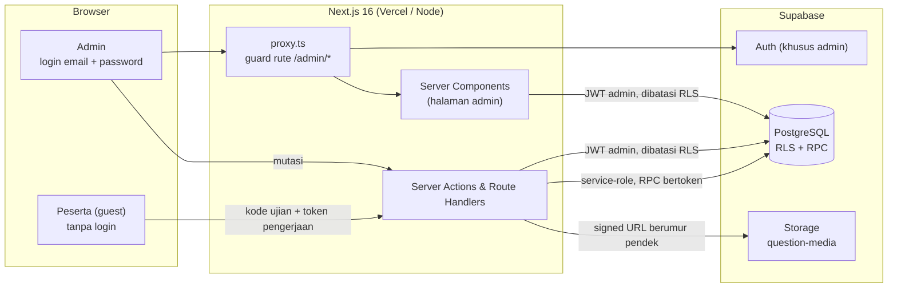
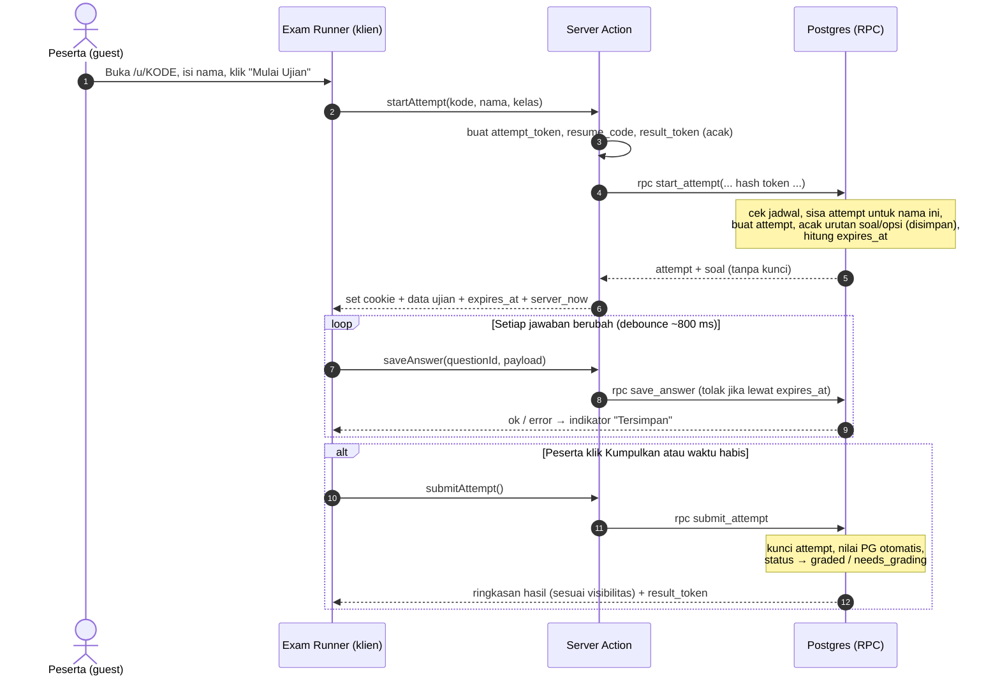
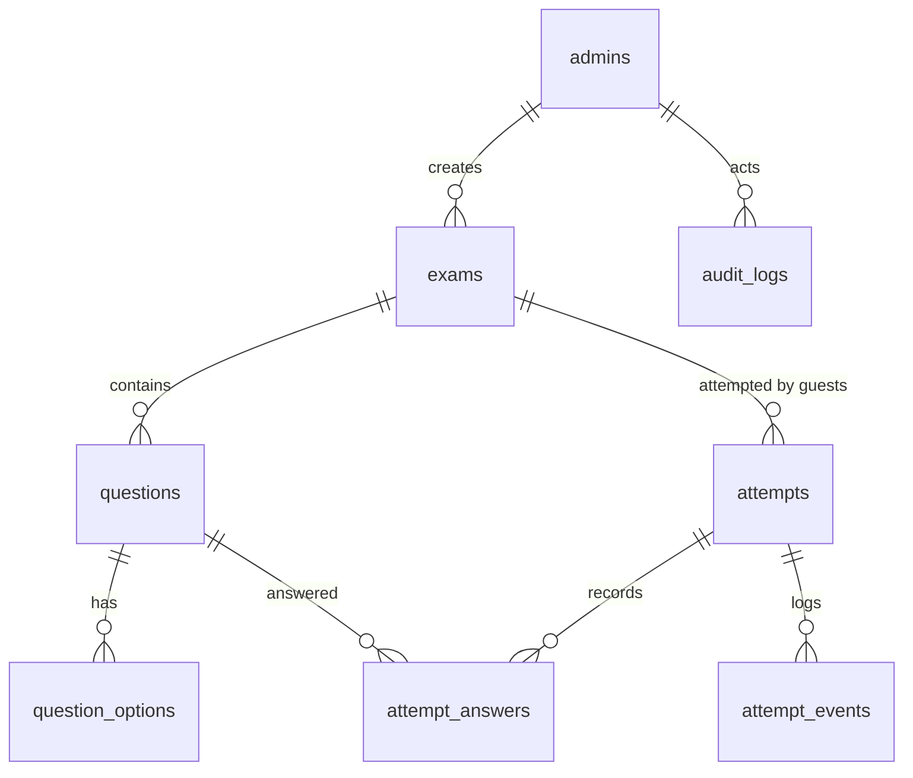

# PRD — KilatCBT: Platform Ujian Online (CBT) Ringan

| | |
|---|---|
| **Versi dokumen** | 2.0 (Draft untuk review) |
| **Tanggal** | 5 November 2026 |
| **Status** | Draft — siap direview sebelum mulai implementasi |
| **Turunan dari** | PRD JawaraCBT v1.0 (4 November 2026) |
| **Tujuan dokumen** | Acuan membangun KilatCBT: aplikasi web ujian online yang ringkas, fokus pada pelaksanaan ujian, penilaian, dan pengelolaan oleh admin |
| **Bahasa produk** | Bahasa Indonesia (default), zona waktu Asia/Jakarta |
| **Pengguna utama** | Admin (pembuat ujian) dan peserta ujian: adik dan teman-teman (tanpa akun) |

## Catatan Versi 2.0

KilatCBT adalah **rebranding sekaligus penyederhanaan** dari JawaraCBT. Perubahan utamanya:

1. **Nama produk** menjadi **KilatCBT**.
2. **Fokus fitur** hanya pada tiga hal: sistem ujian, penilaian, dan sisi admin (membuat soal, mengatur waktu dan pengaturan ujian, melihat hasil).
3. **Modul School Management dihapus**: tahun ajaran, grade level, classroom, mata pelajaran terstruktur, data guru/siswa, penugasan, dokumen siswa, impor massal pengguna, dan profil.
4. **Peserta tanpa login.** Peserta masuk sebagai *guest*: cukup kode ujian dan nama. Tidak ada pendaftaran, email, maupun password untuk peserta.
5. **Peran disederhanakan** dari tiga (Manager, Teacher, Student) menjadi dua: **Admin** (login) dan **Peserta** (guest).

Ringkasan lengkap apa yang dihapus, disederhanakan, dipertahankan, dan ditambahkan ada di [Lampiran A](#17-lampiran). Legenda sumber (✅ / 🔶 / 🔷) dari versi lama dihapus karena KilatCBT tidak lagi dimaksudkan setara fitur dengan produk rujukan; dokumen ini hanya memakai prioritas **P0 / P1 / P2**.

## Daftar Isi

1. [Ringkasan Produk](#1-ringkasan-produk)
2. [Tujuan, Non-Tujuan, dan Metrik](#2-tujuan-non-tujuan-dan-metrik)
3. [Persona](#3-persona)
4. [Peran dan Hak Akses](#4-peran-dan-hak-akses)
5. [Arsitektur Sistem](#5-arsitektur-sistem)
6. [Kebutuhan Fungsional](#6-kebutuhan-fungsional)
7. [Model Data dan Keamanan Database](#7-model-data-dan-keamanan-database)
8. [Kontrak Server Actions dan API](#8-kontrak-server-actions-dan-api)
9. [Spesifikasi UI/UX](#9-spesifikasi-uiux)
10. [Aturan Bisnis dan Edge Case](#10-aturan-bisnis-dan-edge-case)
11. [Kebutuhan Non-Fungsional](#11-kebutuhan-non-fungsional)
12. [Strategi Pengujian](#12-strategi-pengujian)
13. [Roadmap dan Milestone](#13-roadmap-dan-milestone)
14. [Risiko dan Mitigasi](#14-risiko-dan-mitigasi)
15. [Deployment dan Operasional](#15-deployment-dan-operasional)
16. [Pertanyaan Terbuka dan Asumsi](#16-pertanyaan-terbuka-dan-asumsi)
17. [Lampiran](#17-lampiran)

---

## 1. Ringkasan Produk

### 1.1 Deskripsi

KilatCBT adalah aplikasi web untuk menyelenggarakan ujian berbasis komputer (CBT) dengan alur yang sengaja dibuat pendek:

1. **Admin** login, membuat ujian (soal pilihan ganda dan essay, durasi, jadwal, pengaturan), lalu membagikan **kode atau tautan ujian**.
2. **Peserta** membuka tautan, mengisi nama, dan langsung mengerjakan dengan timer. Tidak ada akun.
3. Sistem **menilai otomatis** soal pilihan ganda; admin menilai essay secara manual.
4. Admin melihat **rekap hasil** per ujian dan mengunduhnya.

### 1.2 Masalah yang diselesaikan

| Masalah | Dampak |
|---|---|
| Ujian kertas butuh cetak, pembagian, dan koreksi manual | Boros waktu, rawan salah hitung |
| Aplikasi ujian lain mewajibkan akun dan pendaftaran | Peserta tertahan di tahap login; admin harus membuatkan akun satu per satu |
| Nilai tersebar di chat, kertas, atau spreadsheet terpisah | Sulit direkap dan dibandingkan |

### 1.3 Prinsip produk

- **Fokus ujian.** Setiap fitur harus melayani pelaksanaan ujian, penilaian, atau pengelolaan ujian. Selain itu, tidak masuk.
- **Peserta tanpa gesekan.** Dari membuka tautan sampai soal pertama tampil: maksimal tiga langkah (buka tautan → isi nama → mulai).
- **Admin punya kendali penuh** atas soal, waktu, dan aturan ujian.
- **Kunci jawaban tidak pernah keluar** dari server selama ujian, walau peserta tidak punya akun.

### 1.4 Ruang lingkup

**Dalam lingkup (MVP + v1):** login admin, pembuatan ujian (PG + essay), kode/tautan ujian, akses peserta sebagai guest, pelaksanaan ujian dengan timer dan autosave, penilaian otomatis dan manual, rekap hasil, ekspor, monitoring langsung, impor soal dari CSV/XLSX.

**Di luar lingkup:** manajemen sekolah (kelas, tahun ajaran, mata pelajaran terstruktur, data guru/siswa), akun peserta, aplikasi mobile native, proctoring video/AI, integrasi LMS, pembayaran, absensi, e-rapor, notifikasi email/in-app, bank soal lintas ujian, multi-tenant.

### 1.5 Identitas merek (usulan)

| Elemen | Usulan |
|---|---|
| Nama | **KilatCBT** |
| Tagline | "Ujian online, kilat tanpa ribet" |
| Ikon | Petir sederhana (mudah dibuat sebagai SVG dan favicon) |
| Warna | Aksen kuning-amber untuk tombol utama, biru tua untuk teks dan header (usulan, bebas diganti) |
| Gaya bahasa | Ramah, singkat, sopan. Contoh: "Masukkan nama kamu, lalu mulai." |
| Nama teknis | `NEXT_PUBLIC_APP_NAME=KilatCBT`, prefiks cookie `kilat_`, nama repo `kilatcbt` |

---

## 2. Tujuan, Non-Tujuan, dan Metrik

### 2.1 Tujuan produk

| # | Tujuan | Indikator |
|---|---|---|
| G1 | Admin dapat membuat ujian 20 soal pilihan ganda dalam < 10 menit (atau < 5 menit dengan impor CSV) | Waktu median dari "Buat Ujian" ke "Publish" |
| G2 | Peserta mulai mengerjakan tanpa akun, maksimal 3 langkah | Waktu median dari membuka tautan ke soal pertama ≤ 30 detik |
| G3 | Peserta tidak kehilangan jawaban saat refresh atau koneksi putus | 0 kasus jawaban hilang pada QA dan uji beban |
| G4 | Skor pilihan ganda tersedia seketika setelah submit | Submit → skor ≤ 2 detik (p95) |
| G5 | Menangani ujian serentak untuk kelompok kecil | ≥ 50 peserta serentak tanpa error (diuji sampai 100) |

### 2.2 Non-tujuan (v1)

- Tidak menggantikan sistem proctoring profesional; fitur integritas bersifat pencegahan ringan dan pencatatan (Bagian 6.8).
- Tidak ada akun peserta, riwayat lintas ujian per peserta, atau tracking progres jangka panjang. Tanpa login, identitas peserta hanya nama yang diketik.
- Tidak ada bank soal lintas ujian (soal milik satu ujian; reuse lewat **duplikat ujian**). Bisa dipertimbangkan di v2.
- Tidak ada mode offline penuh dan tidak multi-tenant.

### 2.3 Metrik keberhasilan

| Metrik | Target awal |
|---|---|
| Tingkat penyelesaian ujian (submit / mulai) | ≥ 98% |
| Kegagalan autosave | < 0,5% dari total permintaan |
| Kasus kunci jawaban bocor ke peserta | 0 |
| Waktu admin menilai satu jawaban essay | Berkurang dibanding koreksi kertas (umpan balik admin) |
| Bug kritis per sesi ujian | 0 |

---

## 3. Persona

### P1 — Admin (pembuat dan pengelola ujian)
- **Peran:** Satu atau beberapa orang yang menyiapkan ujian dan memeriksa hasilnya.
- **Kebutuhan:** Membuat soal cepat (ketik atau impor), mengatur durasi dan jadwal, melihat siapa yang sedang mengerjakan, menilai essay, mengunduh rekap.
- **Frustrasi:** Mengetik ulang soal yang sama, menghitung nilai manual, tidak tahu peserta mana yang belum selesai.

### P2 — Peserta (adik dan teman-teman)
- **Peran:** Pelajar yang mengerjakan ujian dari HP atau laptop; tidak punya akun dan tidak mau repot mendaftar.
- **Kebutuhan:** Masuk lewat tautan, timer jelas, navigasi soal mudah, jawaban tidak hilang, melihat nilai setelah selesai.
- **Frustrasi:** Bingung login, takut koneksi putus, layar kecil yang sulit dipakai.

---

## 4. Peran dan Hak Akses

Dua peran: **Admin** (punya akun, login) dan **Peserta** (guest, tanpa akun). Peserta tidak memiliki baris di tabel pengguna mana pun; hak aksesnya dibuktikan oleh **token pengerjaan** (Bagian 5.5).

| Sumber daya | Admin | Peserta (guest) |
|---|---|---|
| Login / akun | Ya | Tidak ada |
| Ujian (buat, ubah, hapus, arsip) | CRUD | Hanya info dasar ujian lewat kode (judul, instruksi, durasi, jumlah soal) |
| Soal, opsi, kunci, pembahasan | CRUD | **Tidak ada akses langsung**; menerima soal **tanpa kunci** hanya selama attempt aktif |
| Attempt (percobaan ujian) | Baca semua, reset, hapus | Membuat dan mengubah milik sendiri selama berjalan (dibuktikan token) |
| Penilaian essay dan koreksi nilai | Ya | — |
| Hasil | Semua | Hasil miliknya lewat tautan hasil, sesuai pengaturan visibilitas |
| Dashboard, rekap, statistik, ekspor | Ya | — |
| Monitoring langsung | Ya | — |
| Ganti password | Ya | — |

> **Aturan penting:** Tidak ada pendaftaran admin publik. Akun admin dibuat oleh pemilik aplikasi (lewat dashboard Supabase atau seed). Asumsi sementara: semua admin dapat mengelola semua ujian (lihat Bagian 16).

---

## 5. Arsitektur Sistem

### 5.1 Stack teknologi

Stack dipertahankan dari JawaraCBT agar tidak ada keputusan teknis baru, dengan komponen yang tidak lagi dibutuhkan dibuang.

| Lapisan | Teknologi |
|---|---|
| Framework | **Next.js 16 (App Router)** |
| Bahasa | **TypeScript** |
| Styling | **Tailwind CSS** |
| Data fetching dan cache klien | **TanStack Query** (v5) |
| Backend terkelola | **Supabase Cloud**: Auth (hanya admin), PostgreSQL, Storage — tanpa self-hosting |
| Klien Supabase untuk SSR | `@supabase/supabase-js` + `@supabase/ssr` |
| Validasi skema | Zod |
| Form | React Hook Form + `@hookform/resolvers` |
| Komponen UI | shadcn/ui (Radix UI) + Lucide Icons |
| Grafik | Recharts (histogram nilai, statistik) |
| Parsing CSV/XLSX | PapaParse / SheetJS (di server) |
| Hosting | **Vercel** (Hobby, non-komersial) — tanpa Node server atau Docker sendiri |
| Pengujian | Vitest, Testing Library, Playwright, k6 |

> **Catatan Next.js 16 (verifikasi di dokumentasi resmi sebelum coding):** konvensi `middleware.ts` diganti namanya menjadi `proxy.ts`; `params` dan `searchParams` bersifat asinkron (`await params`); Turbopack menjadi bundler default; caching bersifat opt-in (mis. direktif `"use cache"`).

### 5.2 Diagram arsitektur tingkat tinggi



### 5.3 Prinsip arsitektur

1. **Peserta tidak punya identitas di database.** Semua akses peserta lewat Server Action yang memanggil **RPC** dengan token pengerjaan. Peran `anon` dan `authenticated` non-admin **tidak punya akses** langsung ke tabel mana pun.
2. **RLS sebagai garis pertahanan.** RLS aktif di semua tabel; satu-satunya policy memberi akses kepada admin.
3. **Service-role key hanya di server** (`import 'server-only'`) dan hanya dipakai untuk memanggil RPC peserta dan menandatangani URL Storage.
4. **Waktu ujian ditentukan server.** Timer di klien hanya tampilan; batas akhir (`expires_at`) dihitung dan divalidasi di database.
5. **Skor dihitung di database.** Kunci jawaban tidak pernah dikirim ke peserta.
6. **Server Components untuk data awal admin, TanStack Query untuk interaksi.**

### 5.4 Struktur folder (App Router)

```text
.
├── src/
│   ├── app/
│   │   ├── (peserta)/
│   │   │   ├── page.tsx                      # landing: input kode ujian
│   │   │   ├── u/[code]/page.tsx             # pra-ujian + isi nama
│   │   │   └── hasil/[resultToken]/page.tsx  # hasil (baca saja)
│   │   ├── (ujian)/                          # layout fullscreen tanpa navigasi
│   │   │   └── u/[code]/kerjakan/page.tsx    # exam runner
│   │   ├── admin/
│   │   │   ├── login/page.tsx
│   │   │   └── (panel)/                      # layout: sidebar + topbar
│   │   │       ├── layout.tsx
│   │   │       ├── page.tsx                  # dashboard
│   │   │       ├── exams/
│   │   │       │   ├── new/                  # wizard
│   │   │       │   └── [id]/
│   │   │       │       ├── page.tsx          # ringkasan + kode/tautan
│   │   │       │       ├── questions/
│   │   │       │       ├── settings/
│   │   │       │       ├── monitor/
│   │   │       │       ├── results/
│   │   │       │       └── grading/[attemptId]/
│   │   │       └── account/                  # ganti password
│   │   ├── api/
│   │   │   ├── import/questions/route.ts
│   │   │   ├── export/results/route.ts
│   │   │   └── health/route.ts
│   │   ├── layout.tsx
│   │   └── not-found.tsx
│   ├── proxy.ts                              # (Next.js 16) guard /admin/*
│   ├── components/
│   │   ├── ui/  layout/  data-table/  charts/
│   │   └── exam/                             # runner, timer, question-nav
│   ├── features/                             # modul per domain
│   │   ├── auth/ exams/ questions/ attempts/ grading/ reports/
│   │   │   ├── actions.ts                    # Server Actions ("use server")
│   │   │   ├── queries.ts
│   │   │   ├── hooks.ts                      # useQuery/useMutation
│   │   │   ├── schemas.ts                    # Zod
│   │   │   └── types.ts
│   ├── lib/
│   │   ├── supabase/ { client.ts, server.ts, admin.ts }
│   │   ├── participant-session.ts            # baca/tulis cookie token pengerjaan
│   │   ├── rate-limit.ts  auth.ts  query-client.ts
│   │   └── errors.ts  utils.ts  constants.ts
│   └── types/database.types.ts               # hasil `supabase gen types`
├── supabase/
│   ├── migrations/                           # skema + RLS + fungsi
│   ├── seed.sql
│   └── config.toml
├── tests/ { unit, e2e, rls, load }
├── .env.example
└── README.md
```

### 5.5 Identitas peserta tanpa login (guest)

Peserta tidak punya akun, tetapi sistem tetap harus tahu **siapa yang memiliki attempt mana**. Caranya: tiga token acak per attempt, dibuat server saat ujian dimulai.

| Token | Fungsi | Penyimpanan | Catatan |
|---|---|---|---|
| `attempt_token` | Bukti kepemilikan attempt; dipakai untuk membaca soal, menyimpan jawaban, dan submit | Cookie `kilat_attempt_<kode>` (httpOnly, Secure, SameSite=Lax). Di database hanya **hash SHA-256**-nya | Minimal 32 byte acak. Tidak pernah tampil di URL |
| `resume_code` | Melanjutkan attempt yang sedang berjalan di perangkat lain atau setelah cookie hilang | Database; ditampilkan ke peserta di layar ujian | 6 karakter (tanpa karakter ambigu seperti 0/O, 1/I); percobaan salah dibatasi |
| `result_token` | Tautan hasil **baca saja** (`/hasil/<token>`) | Database | Terpisah dari `attempt_token`, sehingga membagikan tautan hasil tidak memberi hak mengubah jawaban |

**Alur identitas**

1. Peserta mengisi nama (dan kelas bila diaktifkan admin) di halaman pra-ujian.
2. Server membuat tiga token, menyimpan hash `attempt_token`, lalu memasang cookie.
3. Setiap permintaan peserta membawa cookie; Server Action meneruskan hash token ke RPC; RPC memverifikasi kepemilikan dan status attempt.
4. Bila peserta pindah perangkat: memasukkan kode ujian + nama + `resume_code`. Server menerbitkan `attempt_token` baru dan **mencabut yang lama** (sesi lama otomatis tertutup).

**Aturan nama:** nama dinormalisasi (huruf kecil, spasi dirapikan) untuk menghitung jumlah attempt per ujian. Detail edge case ada di Bagian 10.

### 5.6 Autentikasi dan otorisasi admin

**Alur login**

1. Admin mengirim email + password ke Server Action `signIn`.
2. Supabase Auth mengembalikan sesi; token disimpan di **cookie httpOnly** via `@supabase/ssr`.
3. Aksi memastikan pengguna terdaftar di tabel `admins` dan `is_active`, lalu me-redirect ke `/admin`.
4. `proxy.ts` pada setiap navigasi ke `/admin/*` menyegarkan sesi dan mengalihkan ke `/admin/login` bila belum login.

**Tiga lapis otorisasi (admin)**

| Lapis | Mekanisme | Fungsi |
|---|---|---|
| 1. Rute | `proxy.ts` | Redirect cepat, UX |
| 2. Aksi/Server | `requireAdmin()` di setiap Server Action dan Route Handler admin | Validasi niat + input |
| 3. Data | **RLS Postgres** (`is_admin()`) | Garis pertahanan terakhir |

**Rekomendasi:** gunakan `getUser()` (memverifikasi token ke server Auth) untuk keputusan keamanan, bukan hanya membaca isi cookie di server.

### 5.7 Strategi data fetching dan cache

| Skenario | Pola |
|---|---|
| Daftar admin (ujian, hasil) | Server Component `prefetchQuery` → `HydrationBoundary` → `useQuery` untuk filter dan paginasi |
| Mutasi admin | Server Action → `invalidateQueries` pada key terkait → toast |
| Exam runner (peserta) | Hanya klien: `useMutation` untuk autosave, state lokal untuk navigasi soal |
| Monitoring langsung | `useQuery` dengan `refetchInterval` ≈ 10 detik, berhenti saat tab tidak aktif |
| Dashboard | `staleTime` 60 detik; refetch saat fokus jendela |

**Konvensi query key**

```ts
['exams', { page, pageSize, search, status }]
['exam', examId]
['exam', examId, 'questions']
['results', examId, { page, search, status }]
['monitor', examId]
['attempt', attemptId]
['dashboard']
```

### 5.8 Penyimpanan file (Supabase Storage)

Hanya satu bucket yang tersisa (bucket `avatars`, `student-documents`, dan `imports` dari versi lama dihapus):

| Bucket | Isi | Akses | Batas |
|---|---|---|---|
| `question-media` | Gambar pada soal/opsi | **Privat.** Admin menulis; peserta menerima **signed URL berumur pendek** hanya saat attempt aktif | ≤ 2 MB, jpg/png/webp; dikompres di klien |

Path konvensi: `question-media/{exam_id}/{uuid}.{ext}`. File CSV/XLSX impor soal diproses di memori server dan tidak disimpan.

**Kebijakan akses (diputuskan):** tidak ada policy `select` pada `storage.objects` untuk peran `anon` maupun `authenticated`. RLS Storage tetap aktif tanpa policy baca, sehingga objek tidak dapat diakses langsung meski seseorang mengetahui path-nya. Satu-satunya jalan adalah `createSignedUrl()` dari server memakai service role, diterbitkan hanya saat attempt aktif dan dengan masa berlaku pendek. Admin mengunggah lewat Server Action (bukan langsung dari browser), sehingga tidak perlu policy `insert` untuk `authenticated`.

### 5.9 Alur pelaksanaan ujian (urutan)



### 5.10 Variabel lingkungan

```bash
# .env.example
NEXT_PUBLIC_SUPABASE_URL=https://xxxx.supabase.co
NEXT_PUBLIC_SUPABASE_ANON_KEY=eyJ...          # kunci publik (tidak punya akses data berkat RLS)
SUPABASE_SERVICE_ROLE_KEY=eyJ...              # RAHASIA — hanya server
NEXT_PUBLIC_APP_URL=http://localhost:3000
NEXT_PUBLIC_APP_NAME=KilatCBT
APP_TIMEZONE=Asia/Jakarta
```

### 5.11 Keamanan aplikasi (ringkas)

- Semua input divalidasi Zod di server; validasi klien hanya untuk UX.
- Service-role hanya diimpor dari `lib/supabase/admin.ts` yang diberi `import 'server-only'`.
- Kunci jawaban (`is_correct`, `reference_answer`, `explanation`) tidak pernah di-`select` oleh RPC peserta kecuali pada hasil yang diizinkan visibilitasnya.
- **Rate limiting** pada login admin, `startAttempt`, dan `resumeAttempt` (berbasis IP + kode ujian). **Diputuskan: tabel Postgres** (`rate_limits`) dengan fungsi RPC atomik, tanpa layanan eksternal seperti Upstash.
- Header keamanan (CSP, `X-Frame-Options`, `Referrer-Policy`) lewat konfigurasi Next.js.
- Teks soal dan nama peserta di-*escape*/disanitasi saat dirender untuk mencegah XSS.
- Audit log untuk aksi sensitif admin: ubah nilai, reset attempt, hapus data.

---

## 6. Kebutuhan Fungsional

**Prioritas:** `P0` = wajib MVP · `P1` = rilis v1 · `P2` = pasca-v1.

### 6.1 Autentikasi Admin (AUTH)

| ID | Kebutuhan | Prioritas |
|---|---|---|
| AUTH-01 | Login admin dengan email + password via Supabase Auth | P0 |
| AUTH-02 | Logout dan refresh sesi otomatis | P0 |
| AUTH-03 | Tidak ada pendaftaran publik; akun admin dibuat manual oleh pemilik | P0 |
| AUTH-04 | Admin mengganti password sendiri | P1 |
| AUTH-05 | Rate limit percobaan login (mis. 5 gagal / 15 menit) | P1 |
| AUTH-06 | Lupa password via email (tautan reset) | P2 |

### 6.2 Akses Peserta sebagai Guest (GST)

| ID | Kebutuhan | Prioritas |
|---|---|---|
| GST-01 | Halaman beranda dengan satu input **kode ujian** → menuju halaman pra-ujian | P0 |
| GST-02 | Tautan langsung `/u/{kode}` yang bisa dibagikan admin | P0 |
| GST-03 | Halaman pra-ujian: judul, mata pelajaran/kategori, instruksi, durasi, jumlah soal, sisa percobaan. Form: **nama lengkap** (wajib, 2–60 karakter) dan **kelas** (muncul bila diaktifkan admin) | P0 |
| GST-04 | **Tanpa login/akun/email/password.** Setelah menekan Mulai, sistem memberi token pengerjaan (cookie httpOnly) | P0 |
| GST-05 | **Resume otomatis** lewat cookie setelah refresh atau tab tertutup | P0 |
| GST-06 | **Kode Lanjut** (6 karakter) untuk melanjutkan di perangkat lain atau setelah cookie hilang | P1 |
| GST-07 | Aturan nama: dinormalisasi; jumlah percobaan dihitung per nama ternormalisasi; nama yang sedang mengerjakan tanpa cookie/Kode Lanjut ditolak dengan pesan jelas | P0 |
| GST-08 | Status di pra-ujian: *belum dibuka* (dengan hitung mundur), *berlangsung*, *sudah ditutup*, *kode tidak ditemukan* | P0 |
| GST-09 | Daftar nama peserta terdaftar (whitelist) opsional per ujian | P2 |

### 6.3 Pengelolaan Ujian — Admin (EXM)

| ID | Kebutuhan | Prioritas |
|---|---|---|
| EXM-01 | **Wizard** pembuatan ujian 4 langkah: Info → Soal → Pengaturan → Review dan Publish (Bagian 9.4) | P0 |
| EXM-02 | Field ujian: judul, mata pelajaran/kategori (**teks bebas**), deskripsi, instruksi, jadwal buka–tutup (opsional), **durasi** | P0 |
| EXM-03 | **Kode ujian** 6 karakter unik, dibuat otomatis dan dapat diubah; tombol salin kode dan tautan | P0 |
| EXM-04 | Pengaturan: **acak urutan soal**, **acak urutan opsi**, **maksimal percobaan per nama**, kebijakan nilai akhir (tertinggi/terakhir/pertama/rata-rata), nilai kelulusan (KKM), tampilkan kolom **Kelas** | P0 |
| EXM-05 | Visibilitas hasil untuk peserta: **sembunyikan** / **skor saja** / **skor + pembahasan** | P0 |
| EXM-06 | Waktu rilis hasil: **langsung** / **setelah ujian ditutup** / **manual** oleh admin | P1 |
| EXM-07 | Status ujian: `draft` → `published` → `archived`; simpan draft otomatis | P0 |
| EXM-08 | Validasi sebelum publish: ≥ 1 soal, total poin > 0, durasi > 0, jadwal valid (tutup setelah buka) | P0 |
| EXM-09 | Setelah ada attempt pertama: soal, opsi, dan poin **terkunci**; hanya metadata tertentu (mis. perpanjang waktu tutup, ubah instruksi) yang boleh diubah | P0 |
| EXM-10 | **Duplikat ujian** beserta soalnya (sarana reuse pengganti bank soal) | P1 |
| EXM-11 | **Pratinjau** dari sudut pandang peserta tanpa membuat attempt nyata | P1 |
| EXM-12 | Tombol **Buka sekarang** / **Tutup sekarang** untuk mengesampingkan jadwal | P1 |
| EXM-13 | Ujian yang sudah punya attempt hanya bisa **diarsipkan**; hapus permanen memerlukan konfirmasi (ketik judul ujian) | P0 (arsip) / P1 (hapus permanen) |
| EXM-14 | QR code tautan ujian untuk ditampilkan di layar/dicetak | P2 |

### 6.4 Soal (QST)

Soal **dimiliki langsung oleh satu ujian** (tidak ada bank soal lintas ujian).

| ID | Kebutuhan | Prioritas |
|---|---|---|
| QST-01 | Tipe **pilihan ganda** satu jawaban (2–6 opsi) | P0 |
| QST-02 | Tipe **essay** dengan batas kata (min/maks) | P0 |
| QST-03 | **Poin per soal** (default 1, boleh desimal) | P0 |
| QST-04 | Teks soal dengan format dasar (tebal, miring, daftar) dan **lampiran gambar** pada soal/opsi | P0 |
| QST-05 | Urutkan ulang soal dengan drag-and-drop | P1 |
| QST-06 | Tipe pilihan ganda **banyak jawaban** dengan skor **semua-benar** (mode parsial tidak termasuk lingkup) | P1 |
| QST-07 | **Impor soal dari CSV/XLSX**: unduh template, unggah, pratinjau validasi, laporan error per baris (Bagian 8.4) | P1 |
| QST-08 | Pembahasan per soal (tampil sesuai visibilitas hasil) | P1 |
| QST-09 | Kunci/rubrik acuan untuk essay (hanya terlihat admin) | P1 |
| QST-10 | Rich text lengkap dan **rumus matematika (KaTeX)** | P2 |

**Kriteria penerimaan (QST-07 Impor Soal)**
- **Given** file CSV valid berisi 50 soal, **when** admin mengunggahnya, **then** sistem menampilkan pratinjau 50 soal dengan status per baris (valid/error) sebelum disimpan.
- **Given** baris dengan kunci yang tidak ada di opsi atau tipe tidak dikenal, **then** baris ditandai error dengan pesan jelas dan tidak ikut tersimpan, sementara baris valid tetap bisa diimpor.
- **Given** admin menekan Konfirmasi, **then** soal valid ditambahkan ke ujian (urutan mengikuti file) dan ringkasan jumlah berhasil/gagal ditampilkan.

### 6.5 Pelaksanaan Ujian — Peserta (RUN)

| ID | Kebutuhan | Prioritas |
|---|---|---|
| RUN-01 | **Exam runner**: timer, navigasi soal, tandai ragu, autosave, kumpulkan (Bagian 9.3) | P0 |
| RUN-02 | Timer berbasis server: klien menerima `expires_at` dan `server_now`, lalu menghitung sisa waktu | P0 |
| RUN-03 | Autosave dengan debounce ± 800 ms dan indikator "Menyimpan… / Tersimpan" | P0 |
| RUN-04 | Antrean lokal saat koneksi putus; kirim ulang otomatis setelah pulih; banner "Tidak ada koneksi" | P0 |
| RUN-05 | **Resume**: setelah refresh/koneksi putus, peserta kembali ke attempt aktif dengan jawaban utuh dan sisa waktu benar | P0 |
| RUN-06 | **Auto-submit** saat waktu habis | P0 |
| RUN-07 | Peringatan sisa waktu (5 menit dan 1 menit) | P0 |
| RUN-08 | Dialog konfirmasi Kumpulkan: menampilkan jumlah soal belum dijawab dan yang ditandai ragu | P0 |
| RUN-09 | Halaman selesai: skor sesuai visibilitas, **tautan hasil** untuk disimpan, pesan jika essay masih menunggu penilaian | P0 |
| RUN-10 | Halaman hasil via `result_token` (baca saja), sesuai visibilitas dan waktu rilis | P0 |
| RUN-11 | **Satu sesi aktif** per attempt: lanjut di perangkat lain menutup sesi lama dengan pesan "Ujian dilanjutkan di perangkat lain" | P1 |

**Kriteria penerimaan (Exam Runner)**
- **Given** peserta mengerjakan soal ke-7, **when** ia memilih opsi, **then** UI menampilkan "Menyimpan…" lalu "Tersimpan", dan jawaban tersimpan di server dalam ≤ 2 detik (p95).
- **Given** koneksi terputus, **when** peserta menjawab, **then** jawaban masuk antrean lokal, banner "Tidak ada koneksi" tampil, dan antrean dikirim ulang otomatis saat koneksi pulih tanpa kehilangan urutan.
- **Given** peserta me-refresh halaman, **when** halaman dimuat ulang, **then** attempt dilanjutkan pada soal terakhir dengan semua jawaban dan sisa waktu yang dihitung dari server.
- **Given** `expires_at` terlewati, **when** server menerima jawaban, **then** jawaban ditolak dan attempt di-submit otomatis.
- **Given** peserta membuka ujian di perangkat kedua dengan Kode Lanjut, **then** sesi di perangkat pertama menerima pesan bahwa ujian dilanjutkan di tempat lain.

### 6.6 Penilaian (GRD)

| ID | Kebutuhan | Prioritas |
|---|---|---|
| GRD-01 | **Auto-grading** pilihan ganda saat submit | P0 |
| GRD-02 | **Antrian penilaian essay**: daftar jawaban "perlu dinilai"; tampil jawaban peserta + kunci acuan; input skor (0 s.d. poin maksimal) + komentar; tombol *Berikutnya* untuk menilai beruntun | P0 |
| GRD-03 | Ubah nilai manual dengan alasan wajib; tercatat di audit log | P1 |
| GRD-04 | **Reset / izinkan attempt ulang** untuk peserta tertentu (mis. karena gangguan teknis) | P1 |
| GRD-05 | **Rilis nilai** manual (bila waktu rilis = manual) | P1 |
| GRD-06 | **Analisis butir soal**: persentase peserta yang benar per soal; soal tersulit dan termudah | P1 |
| GRD-07 | Distribusi pilihan opsi per soal (berapa peserta memilih A/B/C/D) | P2 |

### 6.7 Dashboard dan Rekap — Admin (DSH / RPT)

| ID | Kebutuhan | Prioritas |
|---|---|---|
| DSH-01 | **Dashboard admin**: ujian aktif dan mendatang, jumlah peserta yang sedang mengerjakan, attempt hari ini, jumlah jawaban "perlu dinilai", daftar ujian terbaru | P0 |
| RPT-01 | **Rekap per ujian**: tabel peserta (nama, kelas, status, skor, persentase, lulus/tidak, waktu mulai/selesai, durasi, jumlah pelanggaran) dengan pencarian, urut, dan filter | P0 |
| RPT-02 | **Statistik per ujian**: rata-rata, median, tertinggi, terendah, persentase lulus | P0 |
| RPT-03 | Histogram distribusi nilai | P1 |
| RPT-04 | **Detail attempt**: jawaban peserta vs kunci, skor per soal, log kejadian | P0 |
| RPT-05 | **Ekspor** rekap ke CSV/XLSX | P1 |
| RPT-06 | **Monitoring langsung**: peserta yang sedang mengerjakan, jumlah soal terjawab, sisa waktu, jumlah pelanggaran; diperbarui tiap ± 10 detik | P1 |
| RPT-07 | Ekspor PDF / tampilan cetak | P2 |

### 6.8 Integritas Ujian (INT)

> Catatan jujur: kontrol di browser **dapat dilewati** pengguna yang mahir, dan tanpa login siapa pun yang punya kode bisa ikut. Fitur berikut bersifat *pencegahan ringan + bukti pencatatan*, bukan jaminan. Untuk ujian yang penting, bagikan kode hanya kepada peserta yang dituju dan pantau lewat RPT-06.

| ID | Kebutuhan | Prioritas |
|---|---|---|
| INT-01 | Acak urutan soal dan opsi per peserta (urutan disimpan per attempt) | P0 |
| INT-02 | Catat kejadian: tab tidak aktif (`visibilitychange`), keluar fullscreen, paste, dengan stempel waktu | P1 |
| INT-03 | Tampilan log pelanggaran per attempt untuk admin | P1 |
| INT-04 | Catat IP dan user-agent saat mulai (perhatikan privasi; lihat Bagian 11) | P2 |
| INT-05 | Peringatan kepada peserta saat meninggalkan tab ujian | P2 |

### 6.9 Sistem (SYS)

| ID | Kebutuhan | Prioritas |
|---|---|---|
| SYS-01 | Halaman error 403/404/500 yang ramah | P0 |
| SYS-02 | Endpoint `/api/health` untuk pemantauan | P1 |
| SYS-03 | **Audit log** aksi sensitif admin (ubah nilai, reset attempt, hapus) | P1 |
| SYS-04 | Pembersihan data otomatis opsional (hapus attempt lama setelah N hari) | P2 |

---

## 7. Model Data dan Keamanan Database

> Skema ini jauh lebih ramping dari JawaraCBT: dari ±25 tabel menjadi **8 tabel**. Tabel akademik (`academic_years`, `semesters`, `grade_levels`, `classrooms`, `classroom_students`, `subjects`, `topics`, `classroom_subjects`), identitas (`profiles`, `teachers`, `students`, `student_documents`), serta `exam_classrooms`, `exam_questions`, dan tabel kunci terpisah dihapus atau digabung.

### 7.1 Diagram relasi (ERD)



Catatan: **peserta bukan entitas**. Attempt menyimpan nama dan kelas yang diketik peserta langsung di barisnya.

### 7.2 Tipe enum

```sql
create type exam_status       as enum ('draft', 'published', 'archived');
create type question_type     as enum ('mcq_single', 'mcq_multiple', 'essay');
create type attempt_status    as enum ('in_progress', 'needs_grading', 'graded');
create type score_policy      as enum ('highest', 'latest', 'first', 'average');
create type result_visibility as enum ('hidden', 'score_only', 'score_and_review');
create type result_release    as enum ('instant', 'after_close', 'manual');
```

### 7.3 Skema inti (PostgreSQL)

```sql
-- ============ ADMIN ============
create table admins (
  user_id    uuid primary key references auth.users(id) on delete cascade,
  full_name  text not null,
  is_active  boolean not null default true,
  created_at timestamptz not null default now()
);

-- ============ UJIAN ============
create table exams (
  id                  uuid primary key default gen_random_uuid(),
  code                text not null unique check (code ~ '^[A-Z0-9]{4,10}$'),
  created_by          uuid not null references admins(user_id),
  title               text not null,
  subject_label       text,                          -- teks bebas, mis. 'Matematika'
  description         text,
  instructions        text,
  status              exam_status not null default 'draft',
  opens_at            timestamptz,                   -- null = langsung terbuka saat published
  closes_at           timestamptz,                   -- null = terbuka sampai ditutup manual
  duration_minutes    integer not null check (duration_minutes > 0),
  max_attempts        smallint not null default 1 check (max_attempts >= 1),
  score_policy        score_policy not null default 'highest',
  passing_score       numeric(5,2) check (passing_score between 0 and 100),
  shuffle_questions   boolean not null default false,
  shuffle_options     boolean not null default false,
  ask_class           boolean not null default false, -- tampilkan isian Kelas ke peserta
  result_visibility   result_visibility not null default 'score_only',
  result_release      result_release not null default 'instant',
  results_released_at timestamptz,                   -- diisi saat rilis manual / setelah ditutup
  created_at          timestamptz not null default now(),
  updated_at          timestamptz not null default now(),
  check (closes_at is null or opens_at is null or closes_at > opens_at)
);

-- ============ SOAL (milik satu ujian) ============
create table questions (
  id               uuid primary key default gen_random_uuid(),
  exam_id          uuid not null references exams(id) on delete cascade,
  position         integer not null,
  type             question_type not null,
  body             text not null,                    -- teks / Markdown sederhana (disanitasi saat render)
  media_path       text,
  points           numeric(6,2) not null default 1 check (points > 0),
  word_min         integer check (word_min >= 0),    -- khusus essay
  word_max         integer check (word_max > 0),
  reference_answer text,                             -- RAHASIA: acuan essay (admin saja)
  explanation      text,                             -- pembahasan (tampil sesuai visibilitas)
  created_at       timestamptz not null default now(),
  unique (exam_id, position) deferrable initially deferred,
  check (word_max is null or word_min is null or word_max >= word_min)
);

create table question_options (
  id          uuid primary key default gen_random_uuid(),
  question_id uuid not null references questions(id) on delete cascade,
  position    smallint not null,
  body        text not null,
  media_path  text,
  is_correct  boolean not null default false,        -- RAHASIA: tidak pernah dikirim ke peserta
  unique (question_id, position)
);

-- ============ PELAKSANAAN ============
create table attempts (
  id                    uuid primary key default gen_random_uuid(),
  exam_id               uuid not null references exams(id) on delete cascade,
  participant_name      text not null check (char_length(participant_name) between 2 and 60),
  participant_name_norm text not null,               -- huruf kecil, spasi dirapikan (dihitung server)
  participant_class     text,
  attempt_no            smallint not null,
  status                attempt_status not null default 'in_progress',
  submit_reason         text check (submit_reason in ('manual', 'timeout', 'admin')),
  started_at            timestamptz not null default now(),
  expires_at            timestamptz not null,        -- ditetapkan server
  submitted_at          timestamptz,
  question_order        uuid[] not null,             -- urutan soal final per attempt
  option_orders         jsonb,                       -- {question_id: [option_id, ...]}
  score_auto            numeric(7,2) not null default 0,
  score_manual          numeric(7,2) not null default 0,
  max_score             numeric(7,2) not null,
  total_score           numeric(7,2) generated always as (score_auto + score_manual) stored,
  token_hash            text not null,               -- SHA-256 dari attempt_token
  resume_code           text not null,               -- Kode Lanjut (6 karakter)
  result_token          text not null unique,        -- tautan hasil baca saja
  ip_address            inet,                        -- opsional (INT-04)
  user_agent            text,
  unique (exam_id, participant_name_norm, attempt_no)
);
-- maksimal satu attempt aktif per nama per ujian
create unique index one_active_attempt
  on attempts (exam_id, participant_name_norm) where status = 'in_progress';

create table attempt_answers (
  attempt_id          uuid not null references attempts(id) on delete cascade,
  question_id         uuid not null references questions(id) on delete cascade,
  selected_option_ids uuid[],                        -- PG
  essay_text          text,                          -- essay
  is_flagged          boolean not null default false,
  answered_at         timestamptz not null default now(),
  is_correct          boolean,                       -- diisi saat penilaian
  points_awarded      numeric(6,2),
  graded_by           uuid references admins(user_id),
  graded_at           timestamptz,
  feedback            text,
  primary key (attempt_id, question_id)
);

create table attempt_events (                         -- INT-02
  id         bigint generated always as identity primary key,
  attempt_id uuid not null references attempts(id) on delete cascade,
  event_type text not null,                          -- 'tab_hidden', 'fullscreen_exit', 'paste', ...
  meta       jsonb,
  created_at timestamptz not null default now()
);

create table audit_logs (                             -- SYS-03
  id          bigint generated always as identity primary key,
  actor_id    uuid references admins(user_id),
  action      text not null,
  entity      text not null,
  entity_id   text,
  before_data jsonb,
  after_data  jsonb,
  created_at  timestamptz not null default now()
);

-- ============ RATE LIMIT (K2: tabel Postgres, tanpa Upstash) ============
-- Kunci gabungan: aksi + identitas pemanggil (mis. 'login_admin' + IP,
-- 'start_attempt' + kode ujian). Satu baris per jendela waktu.
create table rate_limits (
  bucket       text not null,                        -- 'login_admin', 'start_attempt', ...
  identifier   text not null,                        -- IP, kode ujian, atau gabungan
  window_start timestamptz not null,                 -- awal jendela (dibulatkan)
  counter      integer not null default 0,
  blocked_until timestamptz,                         -- null = belum diblokir
  primary key (bucket, identifier, window_start)
);
```

### 7.4 Indeks yang disarankan

```sql
create index on exams (created_by, status);
create index on exams (opens_at, closes_at) where status = 'published';
create index on questions (exam_id, position);
create index on attempts (exam_id, status);
create index on attempts (exam_id, started_at desc);
create index on attempts (expires_at) where status = 'in_progress';
create index on attempt_answers (question_id);
create index on attempt_events (attempt_id, created_at);
```

### 7.5 Fungsi bantu dan kebijakan RLS

Karena peserta tidak login, **tidak ada policy untuk peserta sama sekali**. Semua tabel dikunci; hanya admin yang punya akses langsung.

```sql
create or replace function public.is_admin()
returns boolean language sql stable security definer set search_path = public as $$
  select exists (select 1 from public.admins where user_id = auth.uid() and is_active)
$$;

-- Aktifkan RLS di SEMUA tabel
alter table admins          enable row level security;
alter table exams           enable row level security;
alter table questions       enable row level security;
alter table question_options enable row level security;
alter table attempts        enable row level security;
alter table attempt_answers enable row level security;
alter table attempt_events  enable row level security;
alter table audit_logs      enable row level security;
-- rate_limits: RLS aktif TANPA policy. Hanya service_role (yang melewati RLS)
-- yang boleh menyentuhnya; klien tidak pernah memanggilnya langsung.
alter table rate_limits     enable row level security;

-- Satu pola policy untuk semua tabel: hanya admin aktif
create policy admin_all on exams
  for all using (is_admin()) with check (is_admin());
create policy admin_all on questions
  for all using (is_admin()) with check (is_admin());
create policy admin_all on question_options
  for all using (is_admin()) with check (is_admin());
create policy admin_all on attempts
  for all using (is_admin()) with check (is_admin());
create policy admin_all on attempt_answers
  for all using (is_admin()) with check (is_admin());
create policy admin_all on attempt_events
  for all using (is_admin()) with check (is_admin());
create policy admin_read on audit_logs
  for select using (is_admin());
create policy admin_self_read on admins
  for select using (user_id = auth.uid());

-- RPC peserta HANYA boleh dipanggil dari server (service_role)
revoke execute on function public.start_attempt(text, text, text, text, text, text, inet, text)
  from public, anon, authenticated;
grant  execute on function public.start_attempt(text, text, text, text, text, text, inet, text)
  to service_role;
-- ...ulangi untuk resume_attempt, get_attempt_state, save_answer,
--    log_attempt_event, submit_attempt, get_result (sesuaikan signature)
```

**Aturan emas RLS untuk ujian**

- Tabel `questions` dan `question_options` memuat kunci (`is_correct`, `reference_answer`, `explanation`). Karena `anon` dan `authenticated` non-admin tidak punya policy, mereka **tidak bisa membaca apa pun** dari tabel ini. Peserta menerima soal **hanya lewat RPC** yang memilih kolom tanpa kunci.
- Peserta tidak punya akses tulis langsung ke `attempt_answers`; semua penulisan lewat RPC `save_answer` agar tidak bisa mengisi `points_awarded` atau `is_correct` sendiri.
- Jangan pernah menambahkan policy `select` untuk `anon` pada tabel di atas, dan jangan menyalakan *Data API* untuk skema lain yang memuat data ujian.
- **Storage `question-media`:** RLS aktif tanpa policy untuk `anon`/`authenticated` (K9). Jangan menambahkan policy baca "supaya gambar cepat tampil" — itu membuka seluruh gambar soal ke siapa pun yang tahu path-nya. Signed URL diterbitkan server saat attempt aktif.
- Uji RLS dan RPC secara otomatis (Bagian 12): `anon` tidak boleh membaca satu baris pun dan tidak boleh memanggil RPC admin.

### 7.6 Fungsi RPC (SECURITY DEFINER)

**RPC peserta** (hanya `service_role`; semua memverifikasi `token_hash`)

| RPC | Logika |
|---|---|
| `start_attempt(code, name, class, token_hash, resume_code, result_token, ip, ua)` | Validasi: ujian ada dan `published`; `now()` dalam `[opens_at, closes_at)` (null = tak dibatasi); nama valid; jumlah attempt untuk `participant_name_norm` < `max_attempts`; **bila ada attempt `in_progress` dengan nama sama → tolak `NAME_IN_USE`** (harus lewat resume). Buat attempt, acak `question_order`/`option_orders` bila diaktifkan, `expires_at = least(now() + durasi, closes_at)`, hitung `max_score`. |
| `resume_attempt(code, name, resume_code, new_token_hash)` | Cocokkan `resume_code` dengan attempt `in_progress` pada nama itu; **ganti `token_hash`** (mencabut sesi lama); kembalikan state. Dibatasi laju. |
| `get_attempt_state(token_hash)` | Kembalikan soal (tanpa kunci) sesuai urutan tersimpan, jawaban tersimpan, flag, `expires_at`, `server_now`. Memanggil `finalize_if_expired` terlebih dahulu. |
| `save_answer(token_hash, question_id, selected, essay, flagged)` | Pastikan attempt milik pemegang token, status `in_progress`, `now() < expires_at`; soal termasuk ujian; essay dipotong/ditolak sesuai `word_max`; *upsert*. |
| `log_attempt_event(token_hash, type, meta)` | Sisipkan ke `attempt_events` (dibatasi laju). |
| `submit_attempt(token_hash)` | Kunci attempt; nilai PG otomatis (bandingkan dengan `is_correct`); isi `score_auto`; status `graded` bila tak ada essay, selain itu `needs_grading`. **Idempoten.** |
| `get_result(result_token)` | Kembalikan hasil sesuai `result_visibility` dan `result_release`; tidak membocorkan kunci bila tidak diizinkan. |

**RPC admin** (`authenticated`, memanggil `is_admin()` di dalamnya)

| RPC | Logika |
|---|---|
| `grade_essay(attempt_id, question_id, points, feedback)` | `0 ≤ points ≤ poin soal`; perbarui `score_manual`; jika semua essay selesai → `graded`. |
| `reset_attempt(attempt_id, mode)` | `mode = 'delete'` menghapus attempt (peserta bisa mulai lagi) atau `'extra'` memberi jatah attempt tambahan; tercatat di `audit_logs`. |
| `release_results(exam_id)` | Mengisi `results_released_at`. |
| `final_score(exam_id, participant_name_norm)` | Menerapkan `score_policy` atas semua attempt `graded`. |

**Pekerjaan terjadwal**

| Fungsi | Logika |
|---|---|
| `expire_overdue_attempts()` | Submit otomatis attempt yang melewati `expires_at` (dijadwalkan tiap menit lewat `pg_cron` atau Edge Function). **Kebenaran tidak bergantung pada cron:** `get_attempt_state`, `save_answer`, dan `get_result` juga memanggil `finalize_if_expired` secara *lazy*. |

### 7.7 Rumus penilaian

```text
Skor PG single   = poin_soal  jika opsi terpilih == kunci, selain itu 0
Skor PG multiple = poin_soal  jika himpunan terpilih == himpunan kunci, selain itu 0
                   (diputuskan: hanya mode "semua benar"; tidak ada mode parsial)
Skor essay       = nilai manual admin (0 .. poin_soal)

total_skor   = Σ skor semua soal
persentase   = total_skor / max_score * 100
lulus        = persentase >= passing_score
nilai_akhir  = f(score_policy) atas semua attempt berstatus graded milik nama yang sama
```

---

## 8. Kontrak Server Actions dan API

Mutasi memakai **Server Actions** (`"use server"`) per fitur. **Route Handlers** hanya untuk impor soal dan ekspor hasil.

### 8.1 Format hasil standar

```ts
type ActionResult<T> =
  | { ok: true; data: T }
  | { ok: false; error: { code: ErrorCode; message: string; fields?: Record<string, string[]> } };

type ErrorCode =
  | 'UNAUTHENTICATED' | 'FORBIDDEN' | 'VALIDATION' | 'NOT_FOUND' | 'CONFLICT'
  | 'EXAM_NOT_FOUND' | 'EXAM_NOT_OPEN' | 'EXAM_CLOSED' | 'NO_ATTEMPTS_LEFT'
  | 'NAME_IN_USE' | 'INVALID_RESUME_CODE' | 'ATTEMPT_EXPIRED'
  | 'RATE_LIMITED' | 'INTERNAL';
```

### 8.2 Daftar aksi

| Domain | Aksi | Pemanggil | Ringkasan |
|---|---|---|---|
| Auth | `signIn`, `signOut`, `updatePassword` | admin | Autentikasi admin |
| Ujian | `createExamDraft`, `updateExam`, `publishExam`, `unpublishExam`, `openExamNow`, `closeExamNow`, `extendCloseTime`, `regenerateExamCode`, `duplicateExam`, `archiveExam`, `deleteExam` | admin | Wizard, status, kode |
| Soal | `createQuestion`, `updateQuestion`, `deleteQuestion`, `reorderQuestions`, `getQuestionImageUploadUrl` | admin | Editor soal |
| Impor | `POST /api/import/questions` (mode `dryRun` dan `commit`) | admin | Multipart CSV/XLSX |
| Peserta | `getExamByCode`, `startAttempt`, `resumeAttempt`, `getAttemptState`, `saveAnswer`, `logAttemptEvent`, `submitAttempt`, `getResult` | peserta (token) | Memanggil RPC lewat service-role |
| Penilaian | `listEssayQueue`, `gradeEssay`, `overrideScore`, `resetAttempt`, `releaseResults` | admin | Penilaian dan rilis |
| Monitoring | `getLiveMonitor(examId)` | admin | Di-poll ± 10 detik |
| Laporan | `GET /api/export/results?examId=&format=xlsx\|csv` | admin | Unduhan |

### 8.3 Konvensi paginasi dan filter

```text
?page=1&pageSize=20&sort=started_at.desc&search=dina&status=needs_grading
```

Respons daftar: `{ rows, total, page, pageSize }`. Paginasi memakai `range()` Supabase atau `limit/offset`.

### 8.4 Template CSV impor soal

```csv
tipe,soal,opsi_a,opsi_b,opsi_c,opsi_d,opsi_e,kunci,poin,pembahasan
pg,"Hasil dari 7 x 8 adalah ...",54,56,58,64,,B,1,"7 x 8 = 56"
pg_banyak,"Manakah yang termasuk bilangan prima?",2,4,5,9,,A|C,2,"2 dan 5 hanya habis dibagi 1 dan dirinya sendiri"
essay,"Jelaskan pengertian fotosintesis dengan kata-katamu sendiri.",,,,,,"Proses tumbuhan membuat makanan dengan bantuan cahaya matahari",5,
```

Aturan:
- `tipe` ∈ {`pg`, `pg_banyak`, `essay`}.
- `kunci` untuk `pg` berisi satu huruf (`A`–`E`); untuk `pg_banyak` dipisah `|` (mis. `A|C`); untuk `essay` berisi **jawaban acuan/rubrik** (hanya terlihat admin).
- Opsi kosong diabaikan; minimal 2 opsi untuk PG; huruf kunci harus merujuk opsi yang terisi.
- `poin` opsional (default 1); `pembahasan` opsional.
- Gambar tidak dapat diimpor lewat CSV; tambahkan lewat editor soal setelah impor.

---

## 9. Spesifikasi UI/UX

> Rancangan yang direkomendasikan, bukan salinan layar produk lain. Prioritas utama: **peserta di HP** dan **admin yang ingin cepat membuat ujian**.

### 9.1 Prinsip desain

- **Mobile-first untuk peserta**: area sentuh ≥ 44 px, teks soal ≥ 16 px, tidak ada scroll horizontal.
- **Desktop-first untuk admin** (tabel, editor), tetap dapat dipakai di tablet.
- **Satu aksi utama per layar** (mis. "Mulai Ujian", "Publish").
- **Status selalu terlihat**: indikator Tersimpan, sisa waktu, status ujian.
- Bahasa Indonesia sederhana dan ramah; pesan error menjelaskan apa yang harus dilakukan.
- Mendukung mode terang; mode gelap opsional (P2).

### 9.2 Peta halaman

| Rute | Untuk | Isi |
|---|---|---|
| `/` | Peserta | Logo KilatCBT, satu input kode ujian, tombol Masuk |
| `/u/[code]` | Peserta | Info ujian, status (belum dibuka/berlangsung/ditutup), form nama (+ kelas), tombol Mulai; kolom Kode Lanjut bagi yang melanjutkan |
| `/u/[code]/kerjakan` | Peserta | Exam runner (layout penuh layar) |
| `/hasil/[resultToken]` | Peserta | Skor dan (bila diizinkan) pembahasan |
| `/admin/login` | Admin | Form login |
| `/admin` | Admin | Dashboard |
| `/admin/exams` | Admin | Daftar ujian: cari, filter status, aksi cepat (salin tautan, duplikat, arsip) |
| `/admin/exams/new` | Admin | Wizard buat ujian |
| `/admin/exams/[id]` | Admin | Ringkasan, kode, tautan, tombol Buka/Tutup sekarang |
| `/admin/exams/[id]/questions` | Admin | Editor soal, impor CSV/XLSX |
| `/admin/exams/[id]/settings` | Admin | Pengaturan ujian |
| `/admin/exams/[id]/monitor` | Admin | Monitoring langsung |
| `/admin/exams/[id]/results` | Admin | Rekap, statistik, ekspor |
| `/admin/exams/[id]/grading/[attemptId]` | Admin | Penilaian essay dan detail attempt |
| `/admin/account` | Admin | Ganti password |

### 9.3 Alur peserta

1. **Beranda** → masukkan kode (atau buka tautan langsung).
2. **Pra-ujian** → baca instruksi, isi nama (dan kelas), tekan **Mulai Ujian**.
3. **Exam runner** → kerjakan soal; **Kode Lanjut** ditampilkan kecil di header/menu agar bisa dicatat.
4. **Konfirmasi Kumpulkan** → ringkasan: "3 soal belum dijawab, 2 ditandai ragu".
5. **Selesai** → skor (sesuai pengaturan), tombol **Salin tautan hasil**.

**Tata letak exam runner (desktop)**

```text
┌──────────────────────────────────────────────────────────────┐
│ Judul Ujian                      ⏱ 42:15     ● Tersimpan     │
├───────────────────────────────────────────┬──────────────────┤
│ Soal 7 dari 20                  [⚑ Ragu]  │  Navigasi soal   │
│                                           │  1  2  3  4  5   │
│ Hasil dari 7 × 8 adalah ...               │  6  7  8  9  10  │
│                                           │  ...             │
│   ( ) A. 54                               │  ■ sudah dijawab │
│   (•) B. 56                               │  □ belum         │
│   ( ) C. 58                               │  ⚑ ragu          │
│   ( ) D. 64                               │                  │
├───────────────────────────────────────────┴──────────────────┤
│ [← Sebelumnya]                   [Berikutnya →]  [Kumpulkan] │
└──────────────────────────────────────────────────────────────┘
```

Di HP: panel **Navigasi soal** menjadi *drawer* yang dibuka dari tombol di header; timer tetap menempel di atas; tombol Sebelumnya/Berikutnya menempel di bawah.

**Perilaku runner**
- Timer berubah warna dan menampilkan peringatan pada sisa 5 menit dan 1 menit.
- Pindah soal tidak memuat ulang halaman; jawaban dikirim di latar belakang.
- Banner kuning "Tidak ada koneksi, jawaban akan dikirim otomatis" saat offline.
- Pintasan keyboard (desktop): panah kiri/kanan pindah soal; A–E memilih opsi.
- Tombol *Back* browser tidak keluar dari ujian tanpa konfirmasi.

### 9.4 Alur admin

**Wizard buat ujian (4 langkah)**

| Langkah | Isi |
|---|---|
| 1. Info | Judul, mata pelajaran/kategori, deskripsi, instruksi |
| 2. Soal | Tambah soal satu per satu atau **impor CSV/XLSX**; atur poin; urutkan |
| 3. Pengaturan | Durasi, jadwal buka–tutup (atau "buka manual"), acak soal/opsi, maks percobaan, KKM, visibilitas dan waktu rilis hasil, isian Kelas |
| 4. Review dan Publish | Ringkasan semua pengaturan, daftar masalah validasi, tombol **Publish**; setelah itu tampil kode ujian, tautan, dan tombol salin |

Draft tersimpan otomatis; admin dapat berhenti dan melanjutkan.

**Editor soal**
- Daftar soal di kiri (nomor, potongan teks, tipe, poin), formulir soal di kanan.
- Opsi PG: tambah/hapus opsi, tandai jawaban benar dengan radio (single) atau checkbox (banyak jawaban).
- Essay: batas kata dan kunci acuan.
- Soal dan opsi terkunci (hanya-baca) dengan penjelasan setelah ada attempt pertama.

**Monitoring langsung (RPT-06)**
- Tabel: nama, kelas, soal terjawab / total, sisa waktu, jumlah pelanggaran, status.
- Ringkasan di atas: "12 sedang mengerjakan · 5 selesai · 0 belum mulai".
- Tombol aksi per baris: lihat detail, reset attempt.

**Penilaian essay (GRD-02)**
- Tampilan dua kolom: jawaban peserta dan kunci acuan di kiri; input skor, komentar, dan tombol **Simpan dan Berikutnya** di kanan.
- Filter: hanya yang belum dinilai; per soal atau per peserta.

**Rekap hasil**
- Kartu statistik: rata-rata, median, tertinggi, terendah, % lulus.
- Histogram distribusi nilai; tabel peserta yang dapat diurutkan; tombol **Unduh CSV/XLSX**.

### 9.5 Status dan keadaan kosong

| Keadaan | Tampilan |
|---|---|
| Kode ujian salah | "Kode tidak ditemukan. Periksa lagi atau minta kode baru ke pembuat ujian." |
| Ujian belum dibuka | Hitung mundur ke `opens_at` |
| Ujian sudah ditutup | Pesan jelas + (bila diizinkan) tautan hasil |
| Belum ada ujian (admin) | Ilustrasi + tombol **Buat ujian pertama** |
| Belum ada peserta | "Belum ada yang mengerjakan. Bagikan kode **ABC123** atau tautan ujian." |
| Memuat | *Skeleton*, bukan spinner layar penuh |
| Error | Pesan ramah + tombol Coba lagi |

### 9.6 Aksesibilitas dan responsivitas

- Kontras warna memenuhi WCAG AA; fokus keyboard terlihat; elemen interaktif punya label.
- Timer tidak hanya mengandalkan warna (ada teks); pengumuman peringatan waktu dapat dibaca *screen reader* (`aria-live="polite"`).
- Breakpoint utama: HP (≤ 640 px), tablet, desktop; diuji di layar 360 px.

---

## 10. Aturan Bisnis dan Edge Case

| Situasi | Perilaku |
|---|---|
| **Nama sama, bukan orang yang sama** (mis. dua teman bernama "Rina") | Admin dapat meminta peserta menambah inisial/kelas. Bila nama sedang mengerjakan, peserta kedua ditolak dengan saran memakai nama lain. Admin bisa melihat dan mereset attempt. |
| **Peserta memakai nama orang lain** | Tidak dapat dicegah tanpa login. Mitigasi: rekap menampilkan waktu mulai dan perangkat (bila INT-04 aktif); fitur whitelist (GST-09) di P2. |
| **Nama dengan huruf besar/kecil/spasi berbeda** ("rina  " vs "Rina") | Dianggap sama (`participant_name_norm`). Nama asli yang diketik tetap ditampilkan di rekap. |
| **Batas percobaan tercapai** | Tombol Mulai ditolak: "Kamu sudah menggunakan semua kesempatan." Admin dapat memberi attempt tambahan (GRD-04). |
| **Refresh / tab tertutup / baterai habis** | Cookie memulihkan attempt; bila cookie hilang, peserta memakai Kode Lanjut. Waktu terus berjalan di server. |
| **Pindah perangkat** | Kode Lanjut mencabut token lama; sesi lama menampilkan pesan dan berhenti menyimpan. |
| **Jam perangkat salah** | Sisa waktu dihitung dari `server_now` yang dikirim server, bukan jam perangkat. |
| **Ujian ditutup saat peserta sedang mengerjakan** | `expires_at = least(mulai + durasi, closes_at)`; waktu habis mengikuti yang lebih dulu. Admin yang memperpanjang `closes_at` tidak mengubah `expires_at` attempt yang berjalan (kecuali lewat fitur tambahan waktu di P2). |
| **Jawaban masuk setelah waktu habis** | Ditolak server; attempt di-submit otomatis dengan alasan `timeout`. |
| **Submit ganda** | `submit_attempt` idempoten; panggilan kedua mengembalikan hasil yang sama. |
| **Admin mengedit soal setelah ada attempt** | Dikunci (EXM-09). Untuk koreksi, admin menduplikat ujian atau mereset attempt. |
| **Hapus ujian yang sudah punya attempt** | Hanya arsip; hapus permanen memerlukan ketik judul sebagai konfirmasi. Penghapusan ikut menghapus semua attempt. |
| **Essay belum dinilai** | Status `needs_grading`. Peserta melihat "Skor sementara (belum termasuk essay)" atau pesan menunggu penilaian, sesuai pengaturan. |
| **Ujian tanpa jadwal** | Terbuka sejak `published` sampai admin menekan **Tutup sekarang** atau mengarsipkan. |
| **Essay melebihi batas kata** | Input menampilkan penghitung kata; server menolak/memotong sesuai `word_max`. |
| **Soal tanpa jawaban terpilih** | Dihitung salah (skor 0); tidak ada pengurangan nilai. |
| **Tautan hasil dibagikan** | Hanya baca, tidak memberi hak mengubah jawaban. Tetap hanya menampilkan data sesuai visibilitas. |
| **Kode ujian diubah admin** | Kode lama langsung tidak berlaku; attempt yang berjalan tetap lanjut karena terikat `exam_id`, bukan kode. |

---

## 11. Kebutuhan Non-Fungsional

| Kategori | Kebutuhan |
|---|---|
| **Performa** | LCP halaman beranda dan pra-ujian ≤ 2,5 detik pada 4G; autosave ≤ 2 detik (p95); submit → skor ≤ 2 detik (p95). Bundel runner dijaga kecil agar nyaman di HP kelas menengah. |
| **Kapasitas** | ≥ 50 peserta serentak tanpa error; diuji sampai 100 (autosave tiap ± 5–10 detik per peserta). |
| **Ketersediaan** | *Best effort* untuk skala kecil. Jadwalkan ujian penting dengan margin dan lakukan uji coba kecil sehari sebelumnya. |
| **Keamanan** | Bagian 5.11 dan 7.5; kunci jawaban tidak pernah dikirim ke peserta; token pengerjaan acak dan hanya disimpan sebagai hash. |
| **Privasi** | Data peserta minimal: **nama** (dan kelas bila diaktifkan). Tidak ada email, telepon, atau alamat. Karena peserta bisa berusia anak/remaja, IP dan user-agent bersifat opsional (INT-04) dan sebaiknya default mati. Admin dapat menghapus attempt kapan saja; pembersihan otomatis di SYS-04. |
| **Kompatibilitas** | Dua versi terakhir Chrome, Edge, Firefox, Safari; Chrome Android dan Safari iOS. Tidak mendukung Internet Explorer. |
| **Aksesibilitas** | WCAG 2.1 AA untuk halaman peserta (Bagian 9.6). |
| **Lokalisasi** | Bahasa Indonesia; zona waktu Asia/Jakarta (WIB) untuk semua tampilan jadwal; waktu disimpan sebagai UTC (`timestamptz`). |
| **Pemeliharaan** | Migrasi skema berversi di `supabase/migrations`; tipe TypeScript dihasilkan dari skema; lint dan typecheck di CI. |
| **Pemulihan data** | Cadangan database mengikuti kemampuan paket Supabase yang dipakai (periksa ketentuan terbaru); ekspor hasil ujian secara berkala (RPT-05) sebagai cadangan tambahan. |
| **Observabilitas** | `/api/health`; log error dari platform hosting (mis. log Vercel); opsional Sentry. Metrik produk (tingkat selesai, kegagalan autosave) cukup dihitung lewat kueri SQL atas `attempts` dan log. |

---

## 12. Strategi Pengujian

| Lapisan | Alat | Cakupan |
|---|---|---|
| **Unit** | Vitest | Rumus penilaian (PG single/multiple semua-benar, essay), normalisasi nama, pembuatan kode, validasi Zod, parser impor CSV |
| **Komponen** | Testing Library | Timer, navigasi soal, indikator autosave, dialog Kumpulkan |
| **RLS dan RPC** | Vitest + klien Supabase lokal | `anon` tidak dapat `select` dari tabel mana pun; `anon` tidak dapat memanggil RPC admin atau RPC peserta secara langsung; token milik attempt A tidak dapat membaca/menulis attempt B; admin nonaktif ditolak; kunci jawaban tidak muncul pada keluaran `get_attempt_state` |
| **End-to-end** | Playwright | Admin: login → buat ujian → impor soal → publish. Peserta: buka tautan → isi nama → kerjakan → refresh di tengah ujian → submit → lihat hasil. Admin: nilai essay → lihat rekap → ekspor |
| **Waktu dan kegagalan** | Playwright + manipulasi jam | Auto-submit saat waktu habis; jawaban ditolak setelah `expires_at`; mode offline lalu online; dua tab/perangkat dengan Kode Lanjut |
| **Beban** | k6 | 100 peserta serentak: mulai, autosave berkala, submit; pantau error dan latensi p95 |
| **UAT (uji penerimaan)** | Manual | Satu uji coba nyata dengan beberapa teman pada HP berbeda sebelum ujian sesungguhnya |

**Kriteria lulus rilis:** semua uji RLS/RPC hijau; skenario e2e utama hijau; uji beban memenuhi target Bagian 11; UAT tidak menemukan bug kritis.

---

## 13. Roadmap dan Milestone

> Perkiraan kasar untuk satu pengembang paruh waktu; sesuaikan dengan waktu yang tersedia. **P0 = MVP** (M1–M4), **P1 = v1** (M5).

| Milestone | Cakupan | Kriteria selesai |
|---|---|---|
| **M1 — Fondasi** (± 1 minggu) | Proyek Next.js 16 + Supabase; skema, RLS, seed admin; login admin dan `proxy.ts`; layout admin; branding KilatCBT (logo, favicon, warna) | Admin dapat login; uji RLS dasar hijau |
| **M2 — Ujian dan soal** (± 1–2 minggu) | CRUD ujian, wizard, kode ujian, editor soal PG + essay, gambar soal, validasi publish, penguncian setelah attempt | Admin dapat membuat dan mempublikasikan ujian lengkap |
| **M3 — Sisi peserta** (± 1–2 minggu) | Beranda dan pra-ujian, `start_attempt`/token/cookie, exam runner (timer, navigasi, autosave, antrean offline, resume), submit dan auto-submit, halaman selesai dan hasil | Peserta dapat mengerjakan dari HP tanpa login; skenario refresh/offline lulus |
| **M4 — Penilaian dan rekap** (± 1 minggu) | Auto-grading PG, antrian dan penilaian essay, rekap per ujian, statistik dasar, detail attempt, dashboard admin, halaman error | **MVP siap dicoba** bersama beberapa teman |
| **M5 — Penyempurnaan v1** (± 1–2 minggu) | Impor soal CSV/XLSX, PG banyak jawaban, drag-and-drop, Kode Lanjut dan satu sesi aktif, monitoring langsung, ekspor CSV/XLSX, rilis nilai manual, duplikat ujian, pratinjau, analisis butir soal, log kejadian integritas, audit log, ganti password | Semua P1 lulus uji; uji beban 100 peserta memenuhi target |
| **Pasca-v1 (P2)** | KaTeX, whitelist nama, QR code, ekspor PDF, lupa password, pembersihan data otomatis, distribusi opsi, mode gelap | Sesuai kebutuhan |

---

## 14. Risiko dan Mitigasi

| Risiko | Dampak | Mitigasi |
|---|---|---|
| Siapa pun yang punya kode/tautan dapat ikut (tanpa login) | Peserta tak dikenal atau kecurangan | Kode unik acak; bagikan hanya ke peserta; jadwal buka–tutup; tombol **Tutup sekarang**; monitoring langsung; whitelist (P2) |
| Peserta memakai nama orang lain atau nama ganda | Data hasil membingungkan | Normalisasi nama; kolom Kelas; admin dapat reset; rekap menampilkan waktu mulai |
| Kunci jawaban bocor ke peserta | Ujian tidak valid | Tidak ada akses tabel untuk `anon`; RPC memilih kolom tanpa kunci; uji RLS/RPC otomatis di CI |
| Cookie hilang/ganti browser di tengah ujian | Peserta terkunci dari attempt-nya | Kode Lanjut (GST-06); admin dapat reset attempt |
| Koneksi buruk di HP | Jawaban hilang | Autosave + antrean lokal + resume; indikator status yang jelas |
| Lonjakan serentak saat ujian dimulai | Galat/lambat | Uji k6; indeks yang tepat; bundel runner ringan; margin waktu mulai |
| Batas paket gratis hosting dan database | Layanan terbatas atau terjeda | Periksa batas Supabase/Vercel terbaru sebelum ujian penting; uji coba sehari sebelumnya; siapkan opsi naik paket |
| Data peserta (anak/remaja) | Isu privasi | Kumpulkan data minimal; IP/UA default mati; kemampuan hapus data; tidak ada pelacak pihak ketiga |
| Admin lupa password | Tidak bisa masuk | Reset lewat dashboard Supabase oleh pemilik; lupa password via email di P2 |
| Waktu server vs perangkat berbeda | Sisa waktu keliru | Semua perhitungan waktu di server (`server_now`, `expires_at`) |
| **Scope creep** (fitur sekolah ingin kembali) | Proyek melebar | Pegang prinsip 1.3; fitur baru harus melayani ujian, penilaian, atau admin ujian |

---

## 15. Deployment dan Operasional

### 15.1 Langkah awal

1. Buat **dua project Supabase Cloud** (`sikilat-dev`, `sikilat-prod`) di region `ap-southeast-1`, lalu jalankan migrasi dari `supabase/migrations` dengan `supabase db push`. Tidak ada Supabase self-hosted, VPS, atau Docker.
2. Buat akun admin pertama di **Supabase Auth**, lalu tambahkan barisnya ke tabel `admins` (lewat `seed.sql` atau SQL manual). Tutup pendaftaran publik (Authentication → Providers → Email → matikan *Allow new users to sign up*).
3. Pastikan RLS aktif di semua tabel dan RPC peserta hanya dapat dieksekusi `service_role` (Bagian 7.5).
4. Buat bucket Storage `question-media` (privat, tanpa policy baca untuk `anon`/`authenticated`; akses hanya lewat signed URL dari server).
5. Deploy aplikasi ke **Vercel**, isi variabel lingkungan (Bagian 5.10); `SUPABASE_SERVICE_ROLE_KEY` hanya sebagai variabel server.
6. Jadwalkan `expire_overdue_attempts()` tiap menit (`pg_cron` atau Edge Function).
7. Pasang **keep-alive** dan **backup `pg_dump`** lewat GitHub Actions. Wajib: paket Free tidak menyediakan backup otomatis dan mem-pause project setelah 7 hari tanpa aktivitas.
8. (Opsional) pasang domain sendiri, mis. `kilatcbt.<domain>`.

### 15.2 Checklist sebelum ujian pertama

- [ ] Admin dapat login dan membuat ujian contoh.
- [ ] Uji coba penuh dari HP: buka tautan → isi nama → kerjakan → refresh → submit → lihat hasil.
- [ ] Uji koneksi putus-nyambung di tengah ujian.
- [ ] Kode dan tautan ujian sudah dites dari perangkat lain.
- [ ] Jadwal buka–tutup dan durasi sudah benar (zona waktu WIB).
- [ ] Soal sudah dicek ulang; kunci jawaban benar.
- [ ] Batas paket Supabase/Vercel sudah dicek; ada rencana jika terjadi gangguan.
- [ ] Admin tahu cara menekan **Tutup sekarang**, mereset attempt, dan mengekspor hasil.

### 15.3 Operasional rutin

- Ekspor hasil setiap ujian selesai sebagai cadangan.
- Arsipkan ujian lama; hapus attempt yang tidak diperlukan (privasi).
- Pantau `/api/health` dan log error saat hari ujian.

---

## 16. Pertanyaan Terbuka dan Asumsi

Dokumen ini memakai asumsi di kolom kanan sampai ada keputusan lain. Mohon dikoreksi bila tidak sesuai.

| # | Pertanyaan | Asumsi sementara |
|---|---|---|
| 1 | Berapa admin, dan apakah tiap admin hanya boleh melihat ujiannya sendiri? | Satu atau beberapa admin; **semua admin dapat mengelola semua ujian** |
| 2 | Perangkat peserta dominan HP atau laptop? | Dominan HP → runner dirancang mobile-first |
| 3 | Apakah ujian punya jadwal ketat atau cukup "buka sampai ditutup manual"? | Keduanya didukung; jadwal bersifat opsional |
| 4 | Apakah peserta boleh melihat nilai dan pembahasan setelah selesai? | Default **skor saja, langsung**; admin dapat mengubah per ujian |
| 5 | Perlu isian **Kelas** dan/atau daftar nama peserta resmi (whitelist)? | Kelas opsional per ujian; whitelist ditunda ke P2 |
| 6 | Apakah soal memuat gambar atau rumus matematika? | Gambar di P0; rumus (KaTeX) di P2 |
| 7 | Perkiraan peserta serentak terbesar? | ≤ 50 (diuji sampai 100) |
| 8 | Hosting: cukup paket gratis? | Cukup untuk awal; periksa batas terbaru |
| 9 | Perlu membatasi satu nama = satu kali ikut, atau boleh mengulang? | Default **1 percobaan per nama**; admin mengubah per ujian |
| 10 | Apakah IP/perangkat peserta perlu dicatat? | **Tidak** secara default (INT-04, P2) |

---

## 17. Lampiran

### Lampiran A — Ringkasan perubahan dari JawaraCBT v1.0

| Kategori | Item |
|---|---|
| **Diganti nama** | JawaraCBT → **KilatCBT** (judul, `NEXT_PUBLIC_APP_NAME`, prefiks cookie `kilat_`) |
| **Dihapus (School Management)** | Tahun ajaran dan semester; grade level; classroom dan penempatan siswa; mata pelajaran dan topik terstruktur; penugasan subject + guru ke kelas; CRUD guru dan siswa (NIP/NIS/NISN, wali, dll.); dokumen pendukung siswa; foto profil; bulk import siswa/guru; kenaikan kelas; pengaturan sekolah |
| **Dihapus (peran dan akun)** | Peran Manager, Teacher, Student; tabel `profiles`, `teachers`, `students`; login siswa/NIS; paksa ganti password; reset password pengguna oleh manager; aktif/nonaktif akun pengguna |
| **Dihapus (fitur lain)** | Notifikasi in-app dan email; rekap per siswa lintas ujian; tracking progres per mata pelajaran; riwayat dan tren performa siswa; dashboard Manager dan Student; bank soal lintas ujian dan topik; token akses ujian (INT-07 lama); bucket `avatars`, `student-documents`, `imports` |
| **Disederhanakan** | Tiga peran → **Admin** dan **Peserta guest**; ±25 tabel → **8 tabel**; mata pelajaran → teks bebas `subject_label`; kunci jawaban digabung ke tabel soal/opsi (dengan akses tertutup untuk peserta); status attempt 5 → 3; visibilitas hasil 4 → 3 + pengaturan waktu rilis terpisah; wizard ujian tanpa langkah pemilihan kelas; folder dan rute lebih sedikit |
| **Dipertahankan** | Stack (Next.js 16, TypeScript, Tailwind, TanStack Query, Supabase); pembuatan ujian PG + essay; acak soal/opsi; kebijakan percobaan dan nilai akhir; KKM; exam runner dengan timer server, autosave, offline queue, resume, auto-submit; auto-grading PG; penilaian essay manual; rekap hasil; ekspor; log integritas ringan; audit log; RLS dan RPC `SECURITY DEFINER` |
| **Ditambahkan** | Akses **guest** (kode ujian + nama); token pengerjaan, Kode Lanjut, dan tautan hasil terpisah; kode/tautan ujian; tombol Buka/Tutup sekarang; **monitoring langsung** untuk admin; **impor soal CSV/XLSX** dinaikkan ke P1; analisis butir soal dinaikkan ke P1; statistik dan histogram nilai; waktu rilis hasil (langsung/setelah ditutup/manual); identitas merek KilatCBT |

### Lampiran B — Glosarium

| Istilah | Arti |
|---|---|
| **Admin** | Pengguna yang login untuk membuat, mengatur, dan menilai ujian |
| **Peserta / guest** | Pengguna tanpa akun yang mengerjakan ujian dengan kode ujian dan nama |
| **Kode ujian** | Kode 6 karakter unik untuk membuka sebuah ujian |
| **Attempt** | Satu kali percobaan pengerjaan ujian oleh satu peserta |
| **Token pengerjaan** | Rahasia acak di cookie yang membuktikan kepemilikan sebuah attempt |
| **Kode Lanjut** | Kode 6 karakter untuk melanjutkan attempt yang sedang berjalan di perangkat lain |
| **Tautan hasil** | Tautan baca-saja ke hasil sebuah attempt |
| **KKM** | Kriteria Ketuntasan Minimal (nilai kelulusan) |
| **RLS** | Row Level Security, pembatasan akses baris di PostgreSQL |
| **RPC** | Fungsi database yang dipanggil dari aplikasi (`SECURITY DEFINER`) |

### Lampiran C — Daftar periksa rebranding teknis

- [ ] Ganti nama di `package.json`, `README.md`, `<title>`, metadata, dan `NEXT_PUBLIC_APP_NAME`.
- [ ] Buat logo dan favicon petir; perbarui warna tema Tailwind.
- [ ] Ganti prefiks cookie dan kunci penyimpanan lokal menjadi `kilat_`.
- [ ] Perbarui teks beranda, pesan error, dan tagline sesuai gaya bahasa (Bagian 1.5).
- [ ] Ganti nama proyek di Supabase dan Vercel serta domain bila ada.
- [ ] Pastikan tidak ada sisa teks "JawaraCBT", "Manager", "Teacher", atau "Student" di kode dan UI.

---

*Akhir dokumen — KilatCBT PRD v2.0*
